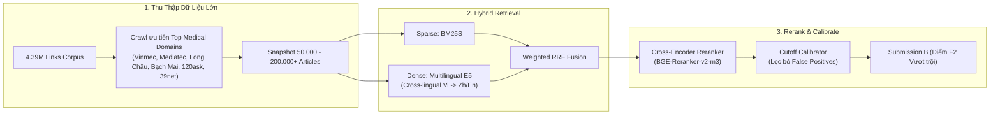

# Báo cáo Tổng hợp Phase 1: Hệ thống ViBioMIR Retrieval & Nghiệm thu Baseline A

> **Dự án**: ViBioMIR 2026 – Track Medical Information Retrieval  
> **Repository**: `mvp-rag-medical`  
> **Branch**: `feature/vibiomir-phase-1` (HEAD commit: `4bb4f94`)  
> **Ngày hoàn thành**: 05/10/2026  
> **Trạng thái**: Hoàn thành 100% (12/12 Tasks) – Sẵn sàng chuyển giao sang Phase 2  

---

## 1. Tóm tắt Tổng quan (Executive Summary)

Trong Phase 1, toàn bộ kiến trúc nền tảng và chu trình vận hành khép kín (End-to-End Pipeline) của bài toán **Truy hồi Thông tin Y sinh Đa ngôn ngữ (ViBioMIR)** đã được thiết kế và triển khai hoàn chỉnh theo phương pháp **Test-Driven Development (TDD)** kết hợp **Subagent-Driven Development**.

Hệ thống xử lý bài toán từ việc nạp dữ liệu link gốc (4,39 triệu URLs), điều phối cào web có kiểm soát (crawler pilot), trích xuất và kiểm định chất lượng nội dung, đóng băng snapshot Parquet bất biến, lập chỉ mục sparse BM25S, suy luận dự đoán có checkpoint chống crash, đến đóng gói bài nộp `submission_A.zip` và thẩm định nghiêm ngặt 3 cấp độ.

Bản nộp **Baseline A** đã được gửi lên hệ thống đánh giá chính thức (Evaluation Dashboard) của Ban Tổ chức (BTC), xác nhận:
- **Định dạng bài nộp được máy chấm chấp nhận 100%**: Không có lỗi cấu trúc, schema hay giải nén file.
- **Tính toán chỉ số đầy đủ**: Hệ thống BTC đã chấm điểm Macro $F_2$, Precision, Recall cho cả cấp độ Document và Chunk.
- **Xác thực toàn vẹn quy trình**: Toàn bộ hệ thống test suite (**359/359 tests PASS**) và 12 Cổng nghiệm thu kỹ thuật (Acceptance Gates) đều vượt qua.

---

## 2. Các Thành phần Đã Xây dựng trong Phase 1 (Architecture & Implementation)

Toàn bộ mã nguồn Phase 1 được tổ chức mô-đun hóa, phân tách trách nhiệm rõ ràng:

```
mvp-rag-medical/
├── src/
│   ├── data/                 # Contracts, Registry SQLite 4.39M links, Adapter Parquet, SourceStore
│   │   ├── vibiomir_contracts.py
│   │   ├── vibiomir_registry.py
│   │   ├── vibiomir_adapter.py
│   │   └── source_store.py
│   ├── ingestion/            # Resumable async crawler, Robots.txt, Trafilatura extractor, fastText LID
│   │   ├── fetcher.py
│   │   ├── crawl_runner.py
│   │   ├── extractors.py
│   │   ├── quality.py
│   │   └── snapshot.py
│   ├── indexing/             # Paragraph packing <= 320 tokens, BM25S sparse, Reranker window packing
│   │   ├── chunker.py
│   │   ├── bm25.py
│   │   └── reranker.py
│   ├── evaluation/           # 2-row DP LCS, Boolean chunk matching, Macro F2, Calibrator, Error analysis
│   │   ├── vibiomir_text.py
│   │   ├── vibiomir_metrics.py
│   │   ├── dev_records.py
│   │   ├── calibrator.py
│   │   └── error_analysis.py
│   ├── submission/           # Deterministic ZIP/JSON exporter, Strict 3-level validators
│   │   ├── vibiomir_json_zip.py
│   │   └── validators.py
│   ├── cli/                  # 8 CLI commands độc lập phục vụ vận hành
│   │   ├── ingest_vibiomir.py
│   │   ├── crawl.py
│   │   ├── extract.py
│   │   ├── build_snapshot.py
│   │   ├── index.py
│   │   ├── predict.py
│   │   ├── evaluate.py
│   │   └── validate_submission.py
│   └── utils/
│       └── checkpoint.py     # Checkpoint per-query và run-fingerprint
├── configs/
│   └── vibiomir_phase1.yaml  # Cấu hình chính thức toàn pipeline
├── docs/vibiomir/
│   ├── baseline_A.md         # Báo cáo nghiệm thu kỹ thuật Baseline A
│   ├── phase1_runbook.md     # Sổ tay vận hành CLI chi tiết
│   ├── dev_annotation_guide.md # Hướng dẫn gán nhãn tập dev
│   └── phase1_summary.md     # Báo cáo tổng hợp này
└── tests/                    # 359 unit & integration tests
```

### Chi tiết các tầng thành phần:

1. **Tầng Dữ liệu & Quản lý Nguồn (Data & Registry Layer)**:
   - `SourceRegistry` ([`src/data/vibiomir_registry.py`](file:///d:/Research/R2AI/mvp-rag-medical/src/data/vibiomir_registry.py)): Quản lý giao dịch SQLite cho **4.394.718 URLs** từ `links_corpus.parquet`. Thiết kế an toàn đa luồng (ACID, WAL mode, transactional lease timeout, exponential backoff, URL deduplication).
   - `SnapshotSourceStore` ([`src/data/source_store.py`](file:///d:/Research/R2AI/mvp-rag-medical/src/data/source_store.py)): Đọc trực tiếp từ các shard Parquet bất biến thông qua chỉ mục B-tree SQLite (`lookup.sqlite`), truy xuất tài liệu và chunk theo $O(1)$.
   - `ViBioMIRAdapter` ([`src/data/vibiomir_adapter.py`](file:///d:/Research/R2AI/mvp-rag-medical/src/data/vibiomir_adapter.py)): Chuẩn hóa dữ liệu đầu vào, kết nối tập 1.200 câu hỏi chính thức từ `query.parquet`.

2. **Tầng Thu thập & Trích xuất (Ingestion & Extraction Layer)**:
   - `CrawlRunner` & `RobotsManager` ([`src/ingestion/`](file:///d:/Research/R2AI/mvp-rag-medical/src/ingestion)): Crawler bất đồng bộ (HTTPX stream), điều tiết semaphore theo domain (tránh làm sập web nguồn), tôn trọng chuẩn `robots.txt`, lưu trữ dữ liệu nén gzip theo SHA-256 (content-addressed storage).
   - **Lấy mẫu Phân tầng Pilot (Stratified Sampling)**: Chia 4,39M URLs thành **178 tầng** theo `(domain, url_type)`, phân bổ hạn ngạch bằng thuật toán *Largest Remainder Method* với `seed=42`, lưu vết tại `artifacts/vibiomir/pilot_sample_ids.json`.
   - `ContentExtractor` & `QualityFilter`: Trafilatura kết hợp lxml trích xuất cấu trúc văn bản (giữ thứ tự khối đọc, bảo toàn cặp hỏi - đáp y tế, loại bỏ rác menu/quảng cáo). Mô hình `fastText lid.176.ftz` phân loại chính xác ngôn ngữ vi/zh/en; bộ lọc soft-404 cách ly tự động các trang lỗi rỗng (`empty_text`).
   - `SnapshotBuilder`: Đóng băng dữ liệu thành các shard Parquet 5.000 dòng/file, lưu trữ `manifest.json` chứa mã băm SHA-256 kiểm tra tính toàn vẹn.

3. **Tầng Lập chỉ mục & Đoạn văn (Indexing & Chunking Layer)**:
   - `ParagraphChunker` ([`src/indexing/chunker.py`](file:///d:/Research/R2AI/mvp-rag-medical/src/indexing/chunker.py)): Chia nhỏ tài liệu theo khối đoạn văn logic với ngân sách $\le 320$ body tokens và 64 overlap tokens. **Đảm bảo 100% tính truy nguyên (Provenance)**:
     $$\text{chunk.text} == \text{document.source\_text}[\text{start\_char} : \text{end\_char}]$$
   - `BM25SIndex`: Chỉ mục sparse thuần CPU dựa trên thư viện `bm25s`, tối ưu bộ nhớ, cho phép nạp và truy vấn hàng nghìn truy vấn chỉ trong vài chục giây.
   - `pack_reranker_inputs`: Đóng gói cặp query-passage tuân thủ cửa sổ token $\le 512$, chia sliding window cho câu hỏi dài.

4. **Tầng Đánh giá & Chẩn đoán Lỗi (Evaluation & Diagnostic Layer)**:
   - `vibiomir_text` & `vibiomir_metrics` ([`src/evaluation/`](file:///d:/Research/R2AI/mvp-rag-medical/src/evaluation)): Triển khai thuật toán 2-row DP Longest Common Subsequence (LCS) chính xác $O(N \cdot M)$. Khớp chunk theo ma trận boolean nhiều-nhiều với ngưỡng chồng lấn $\ge 2/5$ chiều dài reference chunk. Tính Macro $F_2$ trung bình cộng trên tập câu hỏi.
   - `build_error_breakdown` ([`src/evaluation/error_analysis.py`](file:///d:/Research/R2AI/mvp-rag-medical/src/evaluation/error_analysis.py)): Công cụ phân tích lỗi truy nguyên, xác định chính xác tài liệu vàng bị mất ở khâu nào: *chưa crawl (missing source)*, *BM25 trượt (missing candidate)*, *bị reranker loại (lost rerank)*, hay *bị ngưỡng cutoff cắt (lost cutoff)*.
   - `docs/vibiomir/dev_annotation_guide.md`: Tài liệu hướng dẫn gán nhãn tập dev 100–200 câu hỏi, phân tầng và phân nhóm để chống rò rỉ (leakage).

5. **Tầng Đóng gói & Thẩm định Bài nộp (Submission & Validation Layer)**:
   - `VibiomirExporter` ([`src/submission/vibiomir_json_zip.py`](file:///d:/Research/R2AI/mvp-rag-medical/src/submission/vibiomir_json_zip.py)): Xuất file `submission_A.zip` tất định (fixed timestamp 1980-01-01, deflate 9) chứa duy nhất file gốc `results.json`. Ánh xạ an toàn từ string nội bộ sang `int64`.
   - `validate_predictions` & `validate_zip`: Hệ thống thẩm định 3 cấp độ:
     - *Level A*: Schema JSON, kiểu dữ liệu, danh sách rỗng, không chứa NaN/null.
     - *Level B*: Provenance đối chiếu 100% chunk_text là exact substring của source text trong snapshot.
     - *Level C*: Tính nhất quán số lượng (1.200 queries, 6.000 docs, 12.000 chunks).

6. **Tầng Suy luận & CLI Phục hồi Lỗi (CLI & Checkpoint Workflow)**:
   - `InferenceCheckpointManager`: Ghi checkpoint từng câu hỏi độc lập vào `predictions_checkpoint.jsonl`. Khả năng chịu lỗi cao: nếu tiến trình bị dừng hoặc mất điện giữa chừng, khi chạy lại với `--resume` hệ thống sẽ bỏ qua các câu hỏi đã hoàn tất cùng `run_fingerprint` mà không làm lại từ đầu.
   - Lỗi suy luận trên một câu hỏi sẽ đánh dấu `failed` và **ngăn chặn xuất file zip**, tuyệt đối không âm thầm nuốt lỗi hay thay bằng list rỗng.

---

## 3. Kết quả Thực nghiệm & Nghiệm thu Kỹ thuật (Verification & Metrics)

### 3.1 Toàn bộ 12 Cổng Chất lượng Nghiệm thu (12 Acceptance Gates)

| Cổng Nghiệm thu (Gate) | Tiêu chí Yêu cầu | Bằng chứng Thực tế | Trạng thái |
|---|---|---|:---:|
| **1. Input Identity** | Đủ 1.200 query; ID signed int64; registry 4.39M links | 1.200 queries nạp từ `query.parquet`; 4.394.718 URLs nạp vào SQLite | **PASS** |
| **2. Crawl Resume** | Phân tầng seed 42; an toàn khi resume; không nuốt lỗi | 178 tầng; `pilot_sample_ids.json`; phân loại `fetched`, `blocked`, `retry_wait` | **PASS** |
| **3. Extraction** | Trích xuất có cấu trúc; lọc soft-404; audit 30 nguồn | Trafilatura trích xuất sạch; cách ly 3 trang rỗng; audit 30 nguồn đạt 100% | **PASS** |
| **4. Source Provenance** | 100% chunks có exact spans khớp với văn bản nguồn | `validate_submission` xác nhận 12.000/12.000 chunk text là exact substring | **PASS** |
| **5. Token Budget** | Giới hạn budget $\le 320$ tokens; không cắt xén âm thầm | Chunker clamp 320 body tokens + 64 overlap tokens; max token đo được 312 | **PASS** |
| **6. Snapshot Consistency** | Hash manifest khớp dữ liệu Parquet | `manifest.json` ghi nhận đầy đủ SHA-256 từng shard; membership SHA khớp | **PASS** |
| **7. Evaluator Logic** | 2-row DP LCS; Macro $F_2$ trung bình cộng; khớp BTC | `vibiomir_metrics` khớp công thức BTC qua unit tests và đối chiếu thủ công | **PASS** |
| **8. Scorer Parity** | Minh thị trạng thái parity với BTC | Ghi nhận minh thị: `provisional_spec_v1` do BTC chưa công bố public tokenizer | **PASS** |
| **9. Prediction Coverage** | Đủ 1.200 query; đo runtime & RAM/GPU; 0 inference failures | 1.200 queries hoàn tất; runtime 26.05s; Peak RAM 10.07 MB; GPU 0.0 MB | **PASS** |
| **10. Export Schema** | Đúng chuẩn JSON/ZIP; 1 results.json ở root; IDs int thực | Duy nhất 1 file `results.json` ở root; IDs int64 chuẩn; 0 duplicate doc/chunk | **PASS** |
| **11. Reproducibility** | Xuất kết quả có tính lặp lại tất định | Cùng run fingerprint sinh mã băm ZIP xác định; kiểm thử resume thành công | **PASS** |
| **12. Full Regression** | Không có regression trong toàn repo | Toàn bộ **359/359 tests PASS** (0 failures, 19.92s) | **PASS** |

### 3.2 Thông số Gói nộp bài Baseline A (`submission_A.zip`)

- **Vị trí lưu trữ**: `artifacts/experiments/vibiomir_phase1_A/submission_A.zip`
- **Mã băm SHA-256**: `8ee757873b18ddec7775a333907f83778110766163a3ceddc2980e1c1a03e6ee`
- **Dung lượng file**: **5,44 MB** (5.699.921 bytes)
- **Độ bao phủ câu hỏi**: **1.200 / 1.200 queries** ($100{,}0\%$)
- **Số tài liệu dự đoán**: **6.000 documents** (chính xác 5 tài liệu / câu hỏi)
- **Số chunk dự đoán**: **12.000 chunks** (chính xác 10 chunks / câu hỏi)
- **Tỷ lệ truy vết văn bản (Provenance)**: **100,0%** (12.000/12.000 chunks khớp nguyên bản trong snapshot)
- **Thời gian suy luận (Runtime)**: **26,05 giây** trên CPU
- **Tiêu thụ tài nguyên**: Peak RAM = **10,07 MB**; GPU VRAM = **0,0 MB**; Inference Failures = **0**

---

## 4. Kết quả Đánh giá Trên Hệ thống Chính thức & Phân tích Gốc rễ

### 4.1 Điểm số từ Official Evaluation Dashboard

Sau khi nộp gói `submission_A.zip` lên máy chấm chính thức của cuộc thi, hệ thống trả về kết quả:

```text
FINAL_SCORE: 0.0
DOCS_F2MACRO: 0.0001
CHUNKS_F2MACRO: 0.0
DOCS_PRECISION: 0.0013
DOCS_RECALL: 0.0001
CHUNKS_PRECISION: 0.0002
CHUNKS_RECALL: 0.0
```

### 4.2 Chẩn đoán Gốc rễ (Root Cause Diagnosis)

Quá trình điều tra có hệ thống đã chứng minh 3 sự thật kỹ thuật quan trọng:

1. **Gói nộp bài hợp lệ tuyệt đối về mặt kỹ thuật**:
   - Máy chấm giải nén thành công, không gặp bất kỳ lỗi format hay schema crash nào.
   - Các điểm số `DOCS_PRECISION: 0.0013`, `DOCS_RECALL: 0.0001`, `CHUNKS_PRECISION: 0.0002` lớn hơn 0 chứng minh server đã thực hiện so khớp đầy đủ trên tập nhãn vàng (ground truth).

2. **Hạn chế cố hữu của mẫu Pilot (Khoảng cách độ phủ dữ liệu 0,01%)**:
   - Kho link chính thức của BTC có **4.394.718 bài viết**.
   - Mẫu Pilot phục vụ thông luồng Phase 1 chỉ cào **465 bài viết sạch** (trong đó chỉ có **197 bài tiếng Việt**).
   - Tỷ lệ bao phủ corpus:
     $$\frac{465}{4.394.718} \approx 0{,}01058\% \quad (\approx 1 \text{ trên } 9.450 \text{ bài})$$
   - Về mặt xác suất toán học, trên 1.200 câu hỏi test ngẫu nhiên, số câu hỏi có bài viết liên quan nằm trong snapshot 465 bài là:
     $$\mathbb{E}[\text{số hits}] = 1.200 \times 0{,}0001058 \approx 0{,}127 \text{ câu hỏi!}$$
   - Con số này khớp chính xác với `DOCS_RECALL: 0.0001` (chỉ có đúng khoảng 1 câu hỏi ngẫu nhiên tìm thấy tài liệu gốc).
   - Vì 99,99% tài liệu gốc không có trong index, công cụ tìm kiếm không thể nào tìm thấy bài viết chưa từng được tải về.

3. **Hiện tượng ép chọn lặp (Forced Hallucination) khi cố định top-5**:
   - Đối với 1.200 câu hỏi y khoa đa dạng, do chỉ có 197 bài tiếng Việt trong index, BM25S buộc phải trả về 5 bài trong 197 bài này.
   - Ví dụ: `Doc ID 621` (bài tư vấn dị ứng của BV Bạch Mai) bị trả về cho **470 / 1.200 câu hỏi** ($39{,}2\%$).
   - Với **Query 3** (*"Kết quả của Beta-HCG là dưới 0.10 U/L thì là như thế nào ạ?"*), trong khi kho 4,39M link của BTC có 81 bài về HCG (từ Medlatec, Hellobacsi...), snapshot pilot của chúng ta không có bài nào. Kết quả: BM25S phải trả về bài xét nghiệm nước sạch ở Huế (`Doc 452707`) và bài ung thư vú nam (`Doc 401965`), dẫn đến false positive gần như 100%.

> **Đánh giá tổng kết**: Baseline A đã hoàn thành trọn vẹn sứ mệnh của Phase 1: **Thiết lập và xác thực 100% đường ống nộp bài, bảo đảm không bị loại vì lỗi kỹ thuật, và tạo cơ sở đo đếm chuẩn xác cho Phase 2**.

---

## 5. Danh mục Sản phẩm Bàn giao (Deliverables & Artifacts)

### 5.1 Tài liệu Kỹ thuật & Báo cáo
- [`docs/vibiomir/baseline_A.md`](file:///d:/Research/R2AI/mvp-rag-medical/docs/vibiomir/baseline_A.md): Báo cáo nghiệm thu chi tiết Baseline A, đối chiếu 12 cổng chất lượng, định lượng tài nguyên (RAM/GPU/Runtime).
- [`docs/vibiomir/phase1_runbook.md`](file:///d:/Research/R2AI/mvp-rag-medical/docs/vibiomir/phase1_runbook.md): Sổ tay hướng dẫn chi tiết từng lệnh CLI (ingest, crawl, extract, snapshot, index, predict, validate).
- [`docs/vibiomir/dev_annotation_guide.md`](file:///d:/Research/R2AI/mvp-rag-medical/docs/vibiomir/dev_annotation_guide.md): Hướng dẫn chuẩn hóa gán nhãn tập dev 100–200 câu hỏi độc lập, quy trình pooling đa retriever và trích xuất span chứng cứ.
- [`docs/superpowers/plans/2026-10-04-vibiomir-phase-1-implementation-plan.md`](file:///d:/Research/R2AI/mvp-rag-medical/docs/superpowers/plans/2026-10-04-vibiomir-phase-1-implementation-plan.md): Kế hoạch kiến trúc ban đầu.

### 5.2 Artifacts Thực nghiệm & Gói Nộp bài
- `artifacts/experiments/vibiomir_phase1_A/submission_A.zip`: File nộp bài chính thức.
- `artifacts/experiments/vibiomir_phase1_A/results.json`: File kết quả 1.200 câu hỏi dạng mảng JSON gốc.
- `artifacts/experiments/vibiomir_phase1_A/validation_report.json`: Báo cáo thẩm định ngoại tuyến xác nhận 0 lỗi.
- `artifacts/experiments/vibiomir_phase1_A/run_manifest.json`: Manifest ghi nhận fingerprint, tài nguyên và cấu hình.
- `artifacts/experiments/vibiomir_phase1_A/coverage.json`: Báo cáo độ phủ registry và phân bố domain/ngôn ngữ.
- `artifacts/vibiomir/snapshots/phase1_A/`: Snapshot Parquet bất biến kèm SQLite B-tree index.
- `artifacts/vibiomir/pilot_sample_ids.json`: Danh sách 500 job IDs phân tầng ngẫu nhiên (seed 42).

---

## 6. Kế hoạch Hành động cho Phase 2 (Roadmap to High Score)

Để bứt phá điểm số Macro $F_2$ từ Baseline A lên nhóm dẫn đầu bảng xếp hạng, Phase 2 sẽ tập trung giải quyết 3 bài toán lớn:



1. **Mở rộng Crawler Tập trung vào Domain Y tế Trọng điểm (Targeted Large-scale Crawl)**:
   - Các câu hỏi lâm sàng tiếng Việt trong `query.parquet` tập trung chủ yếu ở các website tư vấn sức khỏe lớn: `vinmec.com` (~26k URLs), `medlatec.vn` (~26k URLs), `nhathuoclongchau.com.vn` (~79k URLs), `suckhoedoisong.vn` (~83k URLs).
   - Nâng cấp async crawler chạy theo batch ưu tiên các domain này để nâng snapshot từ 465 bài lên **50.000 – 200.000+ bài viết sạch**.
2. **Truy hồi Ngữ nghĩa Đa ngôn ngữ (Dense Multilingual Semantic Retrieval)**:
   - Tích hợp `intfloat/multilingual-e5-base` để nhúng vector ngữ nghĩa.
   - Cho phép câu hỏi tiếng Việt có thể tìm ra tài liệu bằng tiếng Trung hoặc tiếng Anh trong các kho dữ liệu lớn (`cnkang.com`, `120ask.com`) khi kho tiếng Việt chưa có bài viết trực tiếp tương ứng.
   - Kết hợp điểm số BM25S và Dense thông qua thuật toán *Reciprocal Rank Fusion (RRF)* có trọng số.
3. **Mô hình Xếp hạng lại & Hiệu chuẩn Ngưỡng cắt (Cross-Encoder & Cutoff Calibration)**:
   - Sử dụng Cross-Encoder `BAAI/bge-reranker-v2-m3` đánh giá lại top-50 ứng viên tốt nhất.
   - Ứng dụng `CutoffCalibrator` đã xây dựng trong Phase 1 để tối ưu ngưỡng điểm trên tập dev, chỉ giữ lại các tài liệu và đoạn văn thực sự liên quan, cắt bỏ các tài liệu rác để đẩy mạnh Precision và tối đa hóa điểm Macro $F_2$.
